# Does Forgiveness Pay? Cooperation in the Repeated Prisoner's Dilemma under Noise and Evolution

Aditya Yadav · Game Theory · Instructor: Akash Chauhan · Track B (Computational / Simulation) · November 2026

Code, data and figures: the `pd-forgiveness` repository. Every number in this report is read from a saved result file, and the whole study is reproduced by `python run.py all && python analysis/make_figures.py` (about two minutes on a laptop).

## Abstract

Does it pay to forgive in a world where mistakes happen? We simulate the repeated Prisoner's Dilemma with implementation noise (each move flipped with probability ε) and a random game length (continuation probability δ). We pit 15 strategies, 11 classic and 4 of our own design, against each other in round-robin tournaments, let them evolve under replicator dynamics, and compare the results with six analytic benchmarks. Three findings stand out. First, noise ruins strict reciprocity: Tit-for-Tat against itself falls from 3 to 2.25 points per round for any ε > 0, exactly as a Markov-chain argument predicts, and forgiving strategies lead every tournament up to ε = 0.05. At ε = 0.2, however, unforgiving strategies win again. Second, the best amount of generosity is a plateau of 15–35 % around Nowak and Sigmund's 1/3, and defectors profit once generosity exceeds exactly ½. Third, cooperation emerges between δ = 0.5 and 0.667 as theory predicts, and under noise evolution selects contrition (Contrite TFT) over generosity. Our Reputation Tracker wins tournaments but not evolution.

## 1. Introduction

The Prisoner's Dilemma (PD) captures a basic tension of social life. Two players each choose to cooperate (C) or defect (D). Whatever the other does, defecting pays more, yet two defectors end up worse off than two cooperators. When the game is played once, rational players defect. When it is repeated with an uncertain end, the "shadow of the future" changes the calculation: today's defection can be punished tomorrow, so conditional cooperation becomes rational (Axelrod & Hamilton, 1981).

Axelrod's computer tournaments (Axelrod, 1984) made this idea famous. Tit-for-Tat (TFT), which cooperates first and then copies its opponent's last move, won both tournaments. Axelrod traced its success to four properties: it is *nice* (never the first to defect), *retaliatory*, *forgiving* and *clear*.

Real interactions, however, contain mistakes. A cooperative move may be mis-executed, and TFT has no way to tell an accident from an attack. One error between two TFT players sets off an endless *echo* of alternating retaliation. This observation led to more forgiving strategies: Generous TFT, which sometimes forgives a defection (Nowak & Sigmund, 1992); Win-Stay Lose-Shift, which repairs errors by itself (Nowak & Sigmund, 1993); and Contrite TFT, which accepts punishment for its own mistakes (Boyd, 1989; Wu & Axelrod, 1995).

This project asks whether forgiveness pays under noise, and how much. Specifically:

- **RQ1.** Without noise, which strategies win a round-robin tournament?
- **RQ2.** How does noise change the ranking?
- **RQ3.** What does noise do to TFT against itself?
- **RQ4.** What amount of forgiveness is optimal?
- **RQ5.** Which strategies survive evolution?
- **RQ6.** How does the shadow of the future δ affect cooperation?
- **RQ7.** Do our original strategies beat the known ones anywhere in (ε, δ)?

Each research question received a written prediction before the matching simulation was run, committed to version control so the order can be verified. Each result is then reported as *prediction → figure → agreement or disagreement → explanation*.

## 2. Model

### 2.1 Stage game

Each round both players choose C or D simultaneously and receive the standard Axelrod payoffs: Temptation T = 5, Reward R = 3, Punishment P = 1 and Sucker S = 0. A valid PD requires T > R > P > S, so defecting dominates in a single round, and 2R > T + S, so taking turns exploiting each other is worse than mutual cooperation. The simulator rejects payoffs that violate either condition.

### 2.2 Repetition

After every round the game continues with probability δ. The number of rounds L is therefore geometric with mean 1/(1 − δ): δ = 0.9 gives 10 rounds on average and δ = 0.99 gives 100. Because no player knows which round is the last, backward induction cannot unravel cooperation, as it would with a fixed known length.

We always report the **average payoff per round**, computed as total payoff over all repetitions divided by total rounds over all repetitions. Since round t is reached with probability δᵗ and E[L] = 1/(1 − δ), this ratio estimates exactly the normalised discounted payoff (1 − δ) Σ δᵗ uₜ used by the theory in Section 3. Averaging each match's per-round score instead would overweight short games and bias comparisons at small δ.

### 2.3 Implementation noise

Each player's intended move is flipped with probability ε. Both players observe the move that was actually played, but not the intention behind it. We sweep ε ∈ {0, 0.005, 0.01, 0.02, 0.05, 0.1, 0.2}.

### 2.4 Strategies

The strategy pool comes in three families (full definitions in Appendix A):

- **Classic:** Always Cooperate (ALLC), Always Defect (ALLD), Random (RAND), Tit-for-Tat (TFT), Grim Trigger (GRIM).
- **Forgiving and adaptive:**
  - Generous TFT, GTFT(g), with default g = 1/3.
  - Tit-for-Two-Tats (TF2T).
  - Win-Stay Lose-Shift (WSLS).
  - Suspicious TFT (STFT).
  - Contrite TFT (CTFT).
  - JOSS, which plays TFT but defects 10 % of the time instead of cooperating.
- **Original** (Section 5): Adaptive Forgiver (AF), Grudger with Amnesty (GWA), Prober-Forgiver (PF) and Reputation Tracker (REP).

A strategy sees only the history of actual moves and its own random numbers, and returns its *intended* move. The engine then applies noise. Experiments E1–E6 use the 11 known strategies; E7 adds the four originals.

### 2.5 Tournament

Every strategy plays every strategy, including a copy of itself, since self-play is what a population of that strategy earns. Each pairing is repeated 50 times. Within a repetition all pairings share the same random game length (common random numbers), so differences between strategies are not caused by luckier game lengths. The outputs are:

- **Payoff matrix A**, where A[i][j] is the average per-round payoff of i against j.
- **Cooperation matrix.**
- **Ranking** by mean score against the whole pool, with 95 % confidence intervals from a bootstrap over repetitions (2,000 resamples).

### 2.6 Evolution

Discrete-time replicator dynamics on the payoff matrix: with population shares x, the fitness of strategy i is fᵢ = Σⱼ Aᵢⱼ xⱼ, and its share is updated as xᵢ ← xᵢ fᵢ / f̄, where f̄ = Σᵢ xᵢ fᵢ. Strategies doing better than average grow. We run up to 1,000 generations (2,000 for the δ sweep), stopping early if no share changes by more than 10⁻⁹. A share below 10⁻⁶ is reported as extinct. There are four starting populations:

- **uniform:** all strategies equally common;
- **many defectors:** ALLD 50 %, the rest sharing the other 50 % equally;
- **invasion:** ALLD 95 %, TFT 5 %;
- **WSLS resident:** WSLS 99 %, ALLD 1 % (a direct test of benchmark B6).

### 2.7 Implementation and validation

The simulator is written in Python 3.12 (NumPy, pandas, Matplotlib). Before any experiment ran, 54 automated tests had to pass. The tests check answers that are known exactly:

- ALLC vs ALLD over 10 rounds gives 0 and 5 per round.
- TFT vs ALLD gives 0.9 and 1.4.
- WSLS alternates C/D against ALLD, giving ALLD exactly 3.
- GTFT with g = 0 reproduces TFT move for move, even with noise.
- The noise flip rate over 10⁶ moves is 0.05 ± 0.001.
- The mean game length is within 2 % of 1/(1 − δ).
- In two-strategy replicator dynamics, ALLD beats ALLC, while TFT and ALLC are neutral.

Every match is seeded, with separate random streams for noise and for each player, and a complete rerun reproduces every result file byte for byte.

## 3. Theory: six benchmarks

**B1. Grim Trigger.** Cooperating forever against GRIM is worth R/(1 − δ). Defecting gains T once and then P forever: T + δP/(1 − δ). Cooperation is an equilibrium iff

$$ δ ≥ (T − R)/(T − P) = 0.5 $$

**B2. Tit-for-Tat stability (Axelrod, 1984).** TFT must also resist an alternating cheat (D, C, D, C, …), which earns T, S, T, S, … against it. Comparing (T + δS)/(1 − δ²) with R/(1 − δ) gives δ ≥ (T − R)/(R − S). TFT is collectively stable iff

$$ δ ≥ max((T − R)/(T − P), (T − R)/(R − S)) = max(0.5, 0.667) = 0.667 $$

We therefore predict that cooperation rises steeply between δ = 0.5 and δ = 0.667.

**B3. Always Defect is always an equilibrium.** Against ALLD, cooperating only turns P into S, so D is the best reply at every δ. Cooperators need a critical mass to invade. With a 2 × 2 payoff matrix [[a, b], [c, d]], strategy 1 beats strategy 2 exactly when its share exceeds

$$ x* = (d − b)/((a − c) + (d − b)) $$

For TFT against ALLD at δ = 0.99 this is 0.01/1.97 ≈ 0.51 %.

**B4. TFT against TFT under noise.** Describe the pair by last round's moves (CC, CD, DC or DD). Under TFT the next intended pair is the swap of the current one, a permutation, and noise then flips each move independently. Both steps are doubly stochastic, so the long-run distribution is uniform over the four states and the average payoff is

$$ (R + S + T + P)/4 = 2.25 $$

This holds for **any** ε > 0; ε only sets how quickly the pair gets there. WSLS instead repairs an error in two rounds, (C, D) → (D, D) → (C, C), and should stay near R = 3.

**B5. Optimal generosity (Nowak & Sigmund, 1992).** More generosity repairs errors faster but feeds exploiters. Against GTFT(g), ALLD earns gT + (1 − g)P per round, which stays below R only if g < (R − P)/(T − P) = ½. An alternator earns T + gR + (1 − g)S every two rounds, which stays below 2R only if g < 1 − (T − R)/(R − S) = 1/3. The most generous rule that resists both is

$$ g* = min(1 − (T − R)/(R − S), (R − P)/(T − P)) = 1/3 $$

**B6. A subtlety of WSLS.** Against ALLD, WSLS alternates C and D, so ALLD earns (T + P)/2 = 3 = R. ALLD is therefore exactly as fit as WSLS inside a WSLS population, and fitter when it meets itself (1 vs WSLS's 0.5), so it can spread. WSLS is strictly stable only if R > (T + P)/2. With T = 4.5, (T + P)/2 = 2.75 < 3, and WSLS should repel ALLD.

## 4. Results

Defaults throughout: payoffs (5, 3, 1, 0), δ = 0.99, 50 repetitions per pairing, seed 42.

### 4.1 Baseline tournament without noise (E1, RQ1)

**Prediction.** Nice, retaliating strategies (TFT, GRIM) finish near the top; ALLD wins its head-to-head matches but scores low overall.

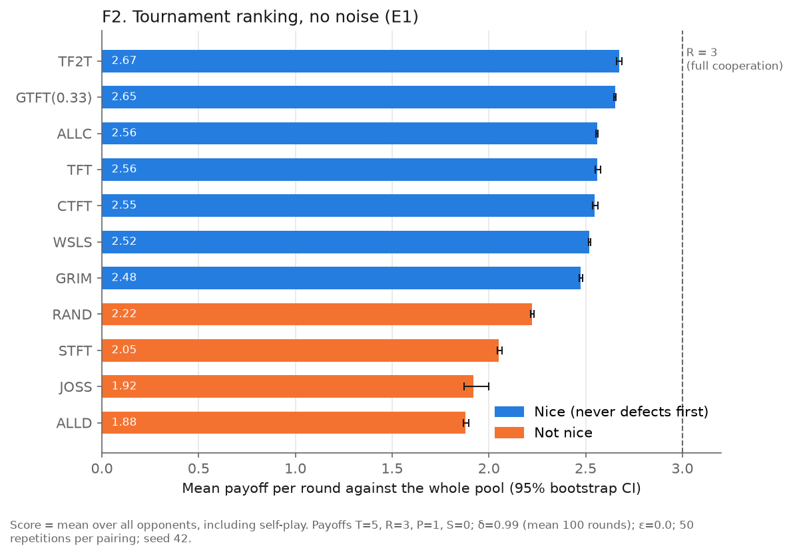{width=0.62}

**Result (Figure F2).** All seven nice strategies finish above all four non-nice ones. ALLD wins 9 of its 10 head-to-head contests yet finishes last (1.878), while TFT wins none and finishes fourth (2.560). The surprise is the top of the table: TF2T (2.674) and GTFT (2.653) beat TFT, and GRIM is the weakest nice strategy (2.475).

**Explanation.** JOSS's random "sneaky" defections act like noise even when ε = 0. Against JOSS, TFT falls into echoes (1.41), while TF2T (2.60) and GTFT (2.56) absorb isolated defections. Against STFT's opening defection, TFT is locked into permanent alternation (2.49), while TF2T and GTFT restore cooperation (2.97). The pool also contains few exploiters, so forgiveness costs little: even ALLC places third. This is consistent with Axelrod (1984), who noted that TF2T would have won his first tournament had anyone entered it, despite being exploitable. **Verdict:** the central claim is confirmed (nice strategies win; beating opponents head-to-head does not), with the identity of the winner depending on the pool. The full payoff matrix is in Appendix D (Figure F1).

### 4.2 Noise sweep (E2, RQ2)

**Prediction.** As ε rises, TFT and GRIM fall, and GTFT, TF2T and WSLS overtake them.

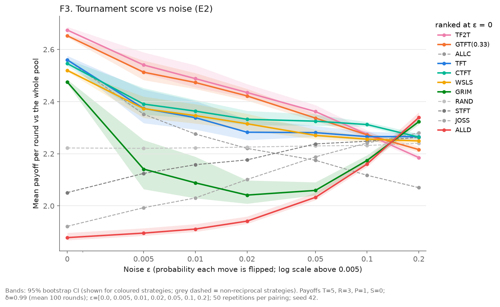{width=0.72}

**Result (Figure F3).**

- **GRIM collapses** (2.475 at ε = 0 to 2.041 at ε = 0.02): one error ends cooperation for good.
- **The forgiving strategies lead.** TF2T and GTFT are first and second at every ε ≤ 0.05, and CTFT is third from ε = 0.005 to 0.05 and first at 0.1. At ε = 0.05, TF2T's interval [2.347, 2.387] lies entirely above TFT's [2.265, 2.306].
- **WSLS is not clearly better than TFT.** It is ahead only at ε = 0.01–0.02, within the CIs. Its weakness against defectors (B6) offsets its self-repair.
- **TFT's score is nearly flat** after the first bit of noise (2.37 → 2.27). This is B4 at work: TFT's self-play payoff has already dropped to 2.25.
- **The ranking inverts at ε = 0.2.** ALLD (2.339) and GRIM (2.323) are first and second, and TF2T and GTFT fall to tenth and ninth.

**Explanation.** A defection is worth forgiving only if it is probably an accident. When a fifth of all moves are random, defections carry almost no information about intent, so forgiving them mostly rewards exploitation, and there is little cooperation left to protect. **Verdict:** confirmed for small and moderate noise, with a new finding: forgiveness has an upper noise limit.

### 4.3 The echo effect (E3, RQ3)

**Prediction (B4).** TFT against itself falls from 3 toward 2.25; WSLS against itself stays near 3 for small ε.

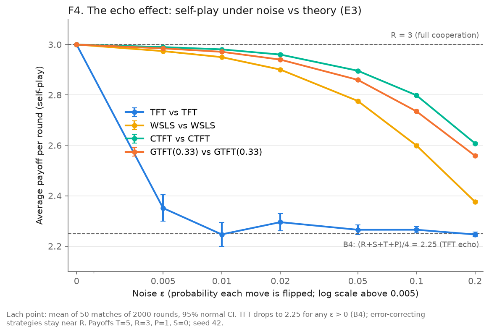{width=0.62}

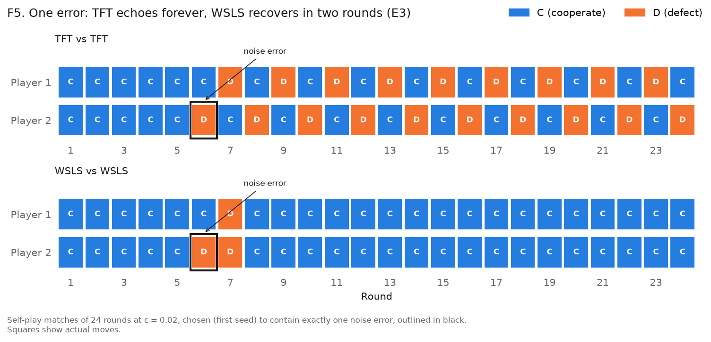{width=0.85}

**Result (Figures F4 and F5).** TFT's self-play payoff jumps from 3.000 to 2.351 at ε = 0.005 and to 2.247 at ε = 0.01, and stays within 0.05 of 2.25 for every larger ε (2.246 at ε = 0.2). The slightly higher value at ε = 0.005 has a simple cause: a match starts in mutual cooperation and waits about 1/(2ε) = 100 rounds for its first error. WSLS stays near R for small noise (2.974 at ε = 0.005, 2.950 at ε = 0.01). CTFT is the best self-player at every noise level (2.896 at ε = 0.05). The move traces show the mechanism: after one error TFT alternates C/D indefinitely, while WSLS passes through one round of mutual defection and returns to cooperation. **Verdict:** confirmed precisely, including the counter-intuitive independence from ε.

### 4.4 The forgiveness dial (E4, RQ4)

**Prediction (B5).** GTFT's best generosity g\* is above 0 and near 1/3; very high g is exploited by ALLD.

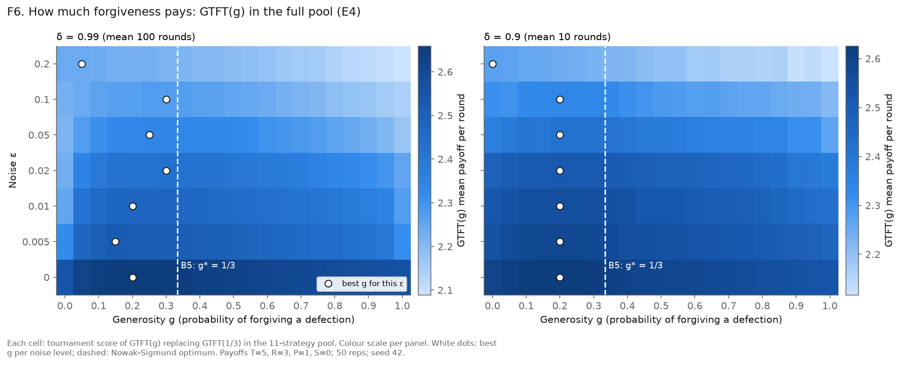{width=0.9}

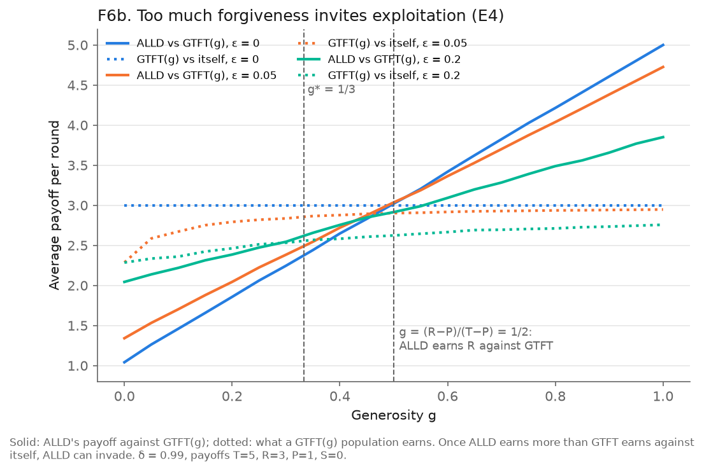{width=0.58}

**Result (Figures F6 and F6b).**

- **An interior optimum.** For every ε ≤ 0.1 the best g is between 0.15 and 0.30 at δ = 0.99, and 0.20 at δ = 0.9. Pure TFT (g = 0) is always worse; at ε = 0.01 it scores 2.250 against 2.478 at g = 0.2.
- **A flat plateau containing 1/3.** At δ = 0.99 the score stays within about 0.01 of the best for g from 0.15 to 0.35.
- **Exploitation beyond ½.** Without noise, ALLD's payoff against GTFT(g) crosses the GTFT population's own payoff of 3 at exactly g = 0.5. That is B5's bound against ALLD, (R − P)/(T − P) = ½, reproduced by simulation.
- **Shifts with δ and ε.** The optimum is lower in shorter games and collapses to g ≈ 0 at ε = 0.2.

**Explanation.** B5 is a *population-stability* argument: the most generosity that cannot be invaded. A tournament score instead measures performance against a fixed field that contains ALLD, RAND and JOSS, each of which profits from every extra unit of generosity. That pulls the tournament optimum slightly below 1/3. Shorter games leave less future to protect, so they need less forgiveness. **Verdict:** confirmed: interior optimum, 1/3 on the plateau, and the exact ½ exploitation threshold.

### 4.5 Evolution (E5, RQ5)

**Prediction.** Without noise, TFT-like strategies take over once defectors die out. With noise, WSLS or GTFT dominate. B6: ALLD is neutral in a WSLS population at T = 5, while WSLS is strictly stable at T = 4.5.

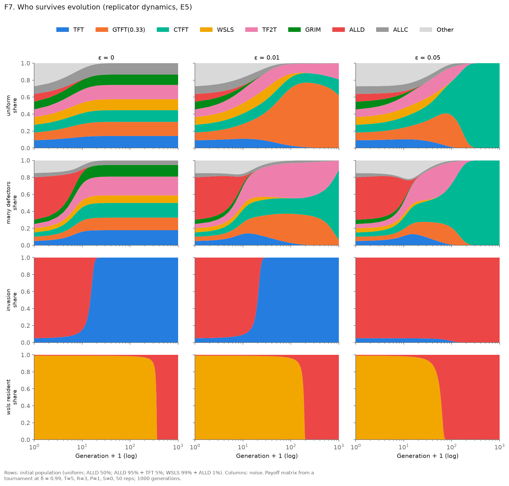{width=0.72}

| Noise ε | Uniform start | ALLD 50 % start | ALLD 95 % + TFT 5 % | WSLS 99 % + ALLD 1 % |
|---|---|---|---|---|
| 0 | 7 nice strategies coexist (12–17 % each) | 7 nice strategies coexist | TFT 100 % | ALLD 100 % |
| 0.01 | GTFT 62 %, CTFT 19 %, TF2T 19 % | CTFT 83 % | TFT 100 % | ALLD 100 % |
| 0.05 | CTFT 100 % | CTFT 100 % | ALLD 100 % | ALLD 100 % |

**Result (Figure F7 and the table).**

- **No noise.** Defectors die out within a few dozen generations, and the seven nice strategies remain at full cooperation. They earn exactly 3 against each other, so selection among them is neutral.
- **With noise, the winner is Contrite TFT, not WSLS:** CTFT reaches 100 % at ε = 0.05 from both broad starting populations.
- **Critical mass.** TFT invades a 95 % ALLD population at ε = 0 and 0.01 but fails at ε = 0.05.

**Explanation.**

- **Why CTFT wins.** Evolution rewards doing well against whatever becomes common, which in the end means yourself. CTFT repairs its own errors immediately (2.896 in self-play at ε = 0.05). Forgiving rivals also cannot invade it: in the 15-strategy matrices at ε = 0.05, CTFT earns 2.907 against itself, while REP, GTFT, TF2T and AF earn only 2.81, 2.82, 2.82 and 2.67 against CTFT. Forgiving players swallow CTFT's justified punishments, while CTFT never lets their errors pass. This is Boyd's (1989) result that contrite strategies are evolutionarily stable under implementation errors.
- **Why the invasion fails at high noise.** The critical mass computed from the simulated matrices with B3's formula rises from 0.53 % (theory: 0.51 %) at ε = 0 to 1.2 % at ε = 0.01 and 5.1 % at ε = 0.05. That is just above the 5 % starting share, so the B3 formula predicts exactly when the invasion should fail. Noise raises the critical mass because it erodes TFT's self-play payoff (2.39 at ε = 0.05).
- **No cycles.** We saw no ALLC → ALLD → TFT cycles: without mutation, an extinct strategy cannot return.

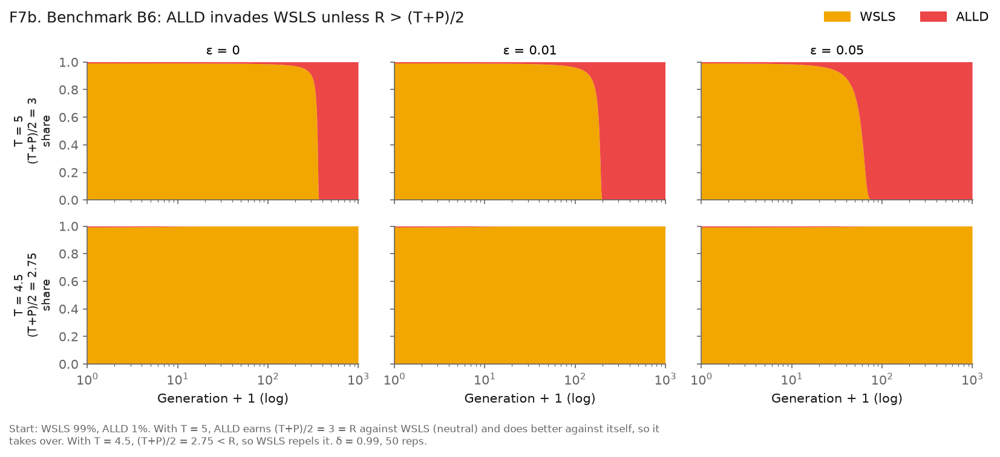{width=0.75}

**B6 (Figure F7b).** With T = 5, ALLD invades the WSLS population at every noise level. Its payoff against WSLS is 3.008 ≈ R, and the WSLS share required to resist, computed with B3's formula, is 1.017, which is impossible. With T = 4.5, ALLD earns only 2.757 against WSLS, and WSLS repels it at every noise level, needing just 67 % of the population (theory: 2/3). Half a point of temptation decides whether WSLS survives, exactly as the algebra predicts. This also explains why WSLS loses the default-payoff evolution above. **Verdict:** confirmed for the no-noise case, the critical mass and B6. The prediction about who wins noisy evolution was wrong (CTFT, not WSLS or GTFT), but established theory explains why.

### 4.6 The shadow of the future (E6, RQ6)

**Prediction (B1, B2).** Cooperation collapses below δ ≈ 0.5 and is stable above δ ≈ 0.667.

{width=0.66}

**Result (Figure F8).** Without noise, equilibrium cooperation is zero for δ ≤ 0.40, then rises: 0.08 at δ = 0.45, 0.28 at 0.50, 0.69 at 0.60, 0.78 at 0.65 and 0.86 at 0.70. It is complete from δ = 0.85. The curve crosses 50 % at δ ≈ 0.57, inside the predicted band. Noise lowers and delays the rise (ε = 0.05: 0.20 at δ = 0.5, 0.47 at 0.65, 0.91 at 0.99).

**Explanation.** Below B1 even permanent punishment cannot deter a one-shot defection, and ALLD takes over. Between B1 and B2, cooperation can be sustained by harsh strategies but not by quickly forgiving ones, so we see mixed populations. The transition is a ramp rather than a step because B1 and B2 are equilibrium conditions, while our populations start from a uniform mix, so near the thresholds the outcome depends on early dynamics. Noise demands a longer shadow of the future, because retaliation is now triggered by accidents as well as cheating. The robustness check in Section 6 shows the thresholds moving with T as the formulas predict. **Verdict:** confirmed.

## 5. Original strategies (E7, RQ7)

We designed four strategies. Their rules, intuitions and predicted niches were committed to the repository after their rule-checking unit tests passed but before any performance experiment ran.

- **Adaptive Forgiver (AF).** TFT, but forgive a defection with probability g = ½ · (s + 1)/(d + 2), where d counts the opponent's defections and s counts "surprise" defections (those right after mutual cooperation). The idea: accidents come out of nowhere, while deliberate defection persists. *Predicted:* matches or beats GTFT for 0.005 ≤ ε ≤ 0.1, and is harder on ALLD.
- **Grudger with Amnesty (GWA).** GRIM with a five-round sentence, with parole if the opponent cooperated in at least 3 of those 5 rounds. *Predicted (PRD):* beats GRIM under noise while keeping its resistance to ALLD.
- **Prober-Forgiver (PF).** Opens C, D, C, C; exploits an opponent that did not retaliate, otherwise plays WSLS. *Predicted:* best against ALLC, mid-table overall, and dies out in evolution.
- **Reputation Tracker (REP).** Keeps an exponentially weighted reputation r ← 0.8 r + 0.2·[opponent cooperated] and cooperates iff r > 0.5. One defection only drops r from 1 to 0.8, while a persistent defector is cut off after four rounds. *Predicted:* top half at moderate-to-high noise.

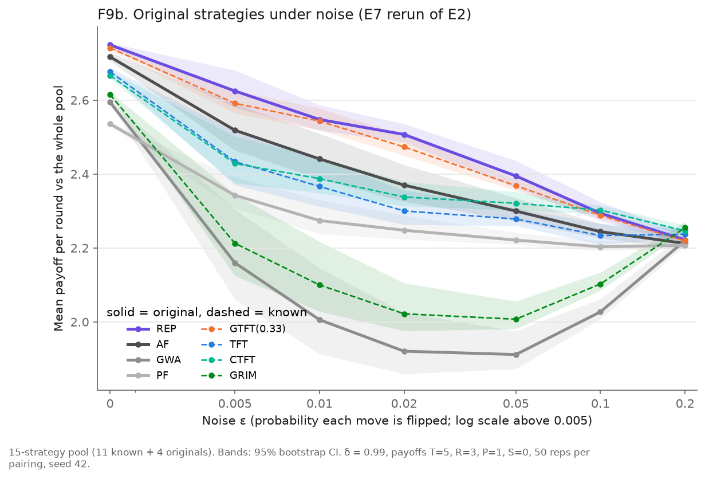{width=0.66}

| Strategy | Prediction | Outcome | Verdict |
|---|---|---|---|
| REP | Top half at 0.02 ≤ ε ≤ 0.1 | 1st for every ε ≤ 0.05, 2nd at 0.1 (tied with GTFT within CIs) | Confirmed, better than predicted |
| AF | Within GTFT's CI or above | 0.05–0.10 below GTFT (ε = 0.01: 2.441 vs 2.543) | Refuted |
| AF | Harder on ALLD than GTFT | 0.959 vs 0.654 against ALLD | Confirmed |
| GWA | Beats GRIM for every ε > 0 | Below GRIM at every ε > 0 (ε = 0.05: 1.912 vs 2.007) | Refuted |
| PF | Best vs ALLC; mid-table; extinct | 4.937 vs ALLC (second only to ALLD's 5); ranks 9–10; extinct | Confirmed |
| All | Survive evolution under noise? | None does; CTFT dominates every noisy long-game cell | — |

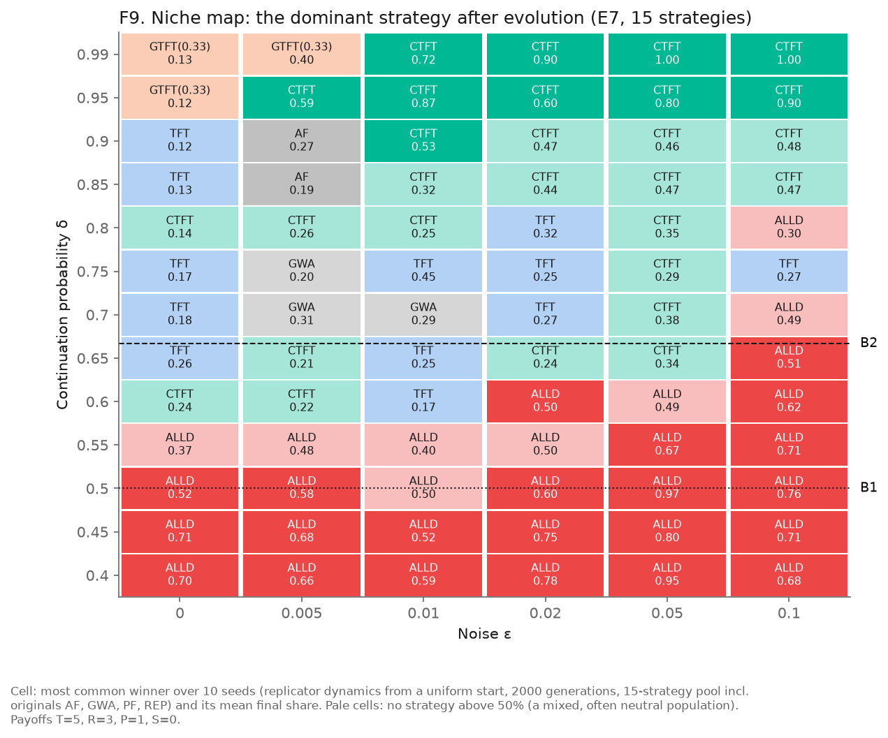{width=0.58}

**Why REP wins tournaments but not evolution.** A reputation separates rare defections from persistent ones, so REP never starts an echo, and unlike TF2T it is not fooled by periodic exploiters (2.48 vs TF2T's 1.51 against PF). But like every forgiving strategy, it can be invaded by CTFT: at ε = 0.05 CTFT earns 3.035 against REP, more than REP earns against itself (2.947). Tournament success, which means doing well against a fixed field, is not the same as evolutionary stability, which means resisting invasion. The niche map (Figure F9) makes this concrete. ALLD owns every cell with δ ≤ 0.55, CTFT owns the noisy long-game corner, and the originals lead only a few mixed, low-share cells: AF at ε = 0.005, δ = 0.85–0.9; GWA at δ = 0.7–0.75.

**Why AF falls short.** AF infers intent from the opponent's defections, but its own punishments contaminate the evidence. When AF retaliates, the opponent's answering defection does not follow mutual cooperation, so it counts as "deliberate", and AF becomes less forgiving exactly when forgiving would end the echo. Against JOSS it scores 1.85, against GTFT's 2.56.

**Why GWA is worse than GRIM.** Parole requires the opponent to cooperate *while being punished*. Retaliators such as TFT and CTFT never do, so against them GWA behaves like GRIM. The opponents who do keep cooperating are the unconditional ones that GRIM, once triggered by noise, exploits profitably: GRIM earns 4.40 against ALLC, 2.90 against WSLS and 2.89 against RAND at ε = 0.05. GWA pardons them and gives that income back (3.25, 2.73, 2.67). Amnesty goes precisely to the players who did not need it.

## 6. Robustness and limitations

**Strategy pool.** Tournament rankings are known to depend on who else plays, so we reran E1, E2 and E5 with three other pools: only the seven nice strategies; a pool where six exploiters (ALLD, STFT, RAND and JOSS at 10, 30 and 50 % sneak rates) face five reciprocators; and a random 8-strategy subset (Appendix D, Figure F11). Every core conclusion held in every pool:

- non-nice strategies never beat nice ones without noise;
- a forgiving strategy (CTFT or TF2T) beats TFT at ε = 0.05;
- GRIM drops several ranks under noise;
- a non-forgiving strategy wins at ε = 0.2;
- CTFT takes over at ε = 0.05 whenever it is present. In the exploiter pool, which lacks CTFT, GTFT (61 %) and TF2T (33 %) take over instead.

Only the identity of the single top strategy changed.

**Payoffs.** We repeated the experiments with T = 4.5 and T = 5.9 (Appendix D, Figure F10). The PRD's T = 6 is not a valid PD with R = 3 and S = 0, because it makes 2R = T + S. The cooperation thresholds moved as B1 and B2 predict:

- **T = 4.5** (B2 = 0.5): cooperation switches on at δ = 0.50–0.55.
- **T = 5.9** (B2 = 0.97): full cooperation (≥ 0.98) is reached only from δ = 0.90.

At T = 5.9 we also found half-cooperative equilibria (about 50 % cooperation) appearing early, at δ = 0.5–0.7. They are populations of STFT, JOSS and TFT locked into C/D alternation, which pays (T + S)/2 = 2.95, almost R. This is a live demonstration of why the PD requires 2R > T + S. B6 and CTFT's evolutionary success held at both values of T.

**Limitations.**

- **Infinite population.** Replicator dynamics models an infinite population, so neutral drift (e.g. among the nice strategies at ε = 0) is absent. A finite-population Moran process would add it.
- **No mutation.** Without mutation, cycles cannot occur and extinct strategies cannot return.
- **Implementation noise only.** We did not model perception noise, where players misread each other and their histories disagree.
- **Fixed, hand-designed pool.** The strategies are memory-limited and chosen by hand; a Zero-Determinant extortioner (Press & Dyson, 2012) or evolved strategies could change the evolutionary picture.
- **Short games are noisy.** At small δ, games last one or two rounds, so the confidence intervals near the thresholds are wide.

These are the natural next steps.

## 7. Conclusion

**Does forgiveness pay?** Yes, when mistakes happen but are rare, and in moderate doses.

- **When.** With any noise at all, strict reciprocity is costly. TFT against itself loses a quarter of its payoff (3 → 2.25, exactly as derived), GRIM collapses, and forgiving strategies lead every tournament up to ε = 0.05 in every pool we tried. But forgiveness has a noise ceiling: at ε = 0.2 defections carry no information, and unforgiving strategies win.
- **How much.** Forgiving about 15–35 % of defections is best, a plateau that contains Nowak and Sigmund's 1/3. Forgiving more than half lets defectors out-earn cooperators, which is the exact B5 threshold. Shorter games call for less forgiveness.
- **What kind.** In evolution the winner is contrition, forgiving the punishment of one's *own* mistakes (Contrite TFT), rather than generosity toward the opponent's. Generous strategies, including our Reputation Tracker, win tournaments but are invaded by contrite ones.
- **Precondition.** None of this works without a sufficient shadow of the future. Cooperation appears between δ = 0.5 and 0.667, as benchmarks B1 and B2 predict, and the threshold moves with the temptation T as the formulas say.

All six analytic benchmarks were reproduced. B4, B6, B5's ½ bound and B3's critical mass match within a few percent, and B1/B2 correctly locate the cooperation transition, including how it moves with T. The disagreements we found, CTFT rather than WSLS in evolution, a tournament optimum slightly below 1/3, and the failures of two original strategies, are each explained by game theory rather than left as anomalies.

## References

*(Cited from the project specification; volumes and page numbers should be verified before submission.)*

1. Axelrod, R. & Hamilton, W. D. (1981). The evolution of cooperation. *Science*, 211, 1390–1396.
2. Axelrod, R. (1984). *The Evolution of Cooperation*. Basic Books.
3. Boyd, R. (1989). Mistakes allow evolutionary stability in the repeated Prisoner's Dilemma game. *Journal of Theoretical Biology*, 136, 47–56.
4. Nowak, M. A. & Sigmund, K. (1992). Tit for tat in heterogeneous populations. *Nature*, 355, 250–253.
5. Nowak, M. A. & Sigmund, K. (1993). A strategy of win-stay, lose-shift that outperforms tit-for-tat in the Prisoner's Dilemma game. *Nature*, 364, 56–58.
6. Wu, J. & Axelrod, R. (1995). How to cope with noise in the iterated Prisoner's Dilemma. *Journal of Conflict Resolution*, 39(1), 183–189.
7. Nowak, M. A. (2006). *Evolutionary Dynamics*. Harvard University Press.
8. Press, W. H. & Dyson, F. J. (2012). Iterated Prisoner's Dilemma contains strategies that dominate any evolutionary opponent. *PNAS*, 109(26), 10409–10413.
9. Knight, V. et al. (2016). An open framework for the reproducible study of the iterated Prisoner's Dilemma. *Journal of Open Research Software*.

\pagebreak

## Appendix A. Strategy definitions

| Code | Rule | Nice? | Source |
|---|---|---|---|
| ALLC | Always C | Yes | Axelrod (1984) |
| ALLD | Always D | No | Axelrod (1984) |
| RAND | C with probability 0.5 | No | Axelrod (1984) |
| TFT | C first, then copy the opponent's last move | Yes | Axelrod (1984) |
| GRIM | C until the opponent defects once, then D forever | Yes | Axelrod (1984) |
| GTFT(g) | TFT, but after an opponent D cooperate with probability g (default 1/3) | Yes | Nowak & Sigmund (1992) |
| TF2T | D only if the opponent defected in both of the last two rounds | Yes | Axelrod (1984) |
| WSLS | Repeat the last move after R or T, switch after P or S | Yes | Nowak & Sigmund (1993) |
| STFT | D first, then copy the opponent | No | Axelrod (1984) |
| CTFT | TFT, but after its own accidental D, accept one punishment without retaliating | Yes | Boyd (1989); Wu & Axelrod (1995) |
| JOSS | TFT, but defect with probability 0.1 when TFT says C | No | Axelrod (1984) |
| AF | TFT; forgive a D with probability ½ · (surprise Ds + 1)/(all Ds + 2) | Yes | Original |
| GWA | GRIM with 5-round sentences; parole if the opponent cooperated in ≥ 3 of them | Yes | Original |
| PF | Open C, D, C, C; exploit if no retaliation, else WSLS | No | Original |
| REP | Cooperate iff reputation r > 0.5, where r ← 0.8 r + 0.2·[opponent cooperated], r₀ = 1 | Yes | Original |

CTFT is implemented with the operational rule above, a simplification of Boyd's "standing" formulation that behaves identically after a single error.

## Appendix B. Experiment parameters

| Experiment | Varies | Fixed | Runs |
|---|---|---|---|
| E1 | — | ε = 0, δ = 0.99 | 1 tournament |
| E2 | ε ∈ {0, 0.005, 0.01, 0.02, 0.05, 0.1, 0.2} | δ = 0.99 | 7 tournaments |
| E3 | ε (as E2); TFT, WSLS, CTFT, GTFT self-play | 2,000 rounds | 50 matches per point |
| E4 | g ∈ {0, 0.05, …, 1}; ε (as E2); δ ∈ {0.99, 0.9} | full pool | 294 tournaments |
| E5 | ε ∈ {0, 0.01, 0.05}; T ∈ {5, 4.5}; 4 starting populations | δ = 0.99 | 1,000 generations |
| E6 | δ ∈ {0.1, 0.2, 0.3, 0.4, 0.45, …, 0.95, 0.99}; ε ∈ {0, 0.01, 0.05} | uniform start | 30 seeds per point, 2,000 generations |
| E7 | E2, E5 and E6 reruns with 15 strategies; ε ≤ 0.1 niche grid | — | 10 seeds per cell |
| R1 | 3 alternative pools | as E1, E2, E5 | — |
| R2 | T ∈ {4.5, 5.9} | as E2, E5, E6 (ε ∈ {0, 0.01}) | 10 seeds per point |

All runs: payoffs (T, R, P, S) = (5, 3, 1, 0) unless stated, 50 repetitions per pairing, base seed 42, 95 % CIs. Full configurations are in `configs/`.

## Appendix C. Validation tests

The 54 automated tests check, among others:

- the exact payoffs in the 10-round matches listed in Section 2.7;
- that every nice strategy cooperates fully with itself;
- the scripted behaviour of TF2T, GRIM, STFT, CTFT and the four originals;
- that GTFT(0) equals TFT and GTFT(1) equals ALLC move for move under noise;
- seeding (same seed gives the same histories, different seeds differ);
- the noise flip rate and the mean game length;
- TFT self-play ≈ 2.25 under noise;
- exact tournament matrices without noise;
- that adding a strategy to the pool leaves the existing matches unchanged;
- replicator dynamics: shares stay on the simplex, ALLD beats ALLC, TFT and ALLC are neutral;
- the TFT-vs-ALLD critical share against the B3 formula;
- B6 at T = 5 vs T = 4.5.

## Appendix D. Additional figures

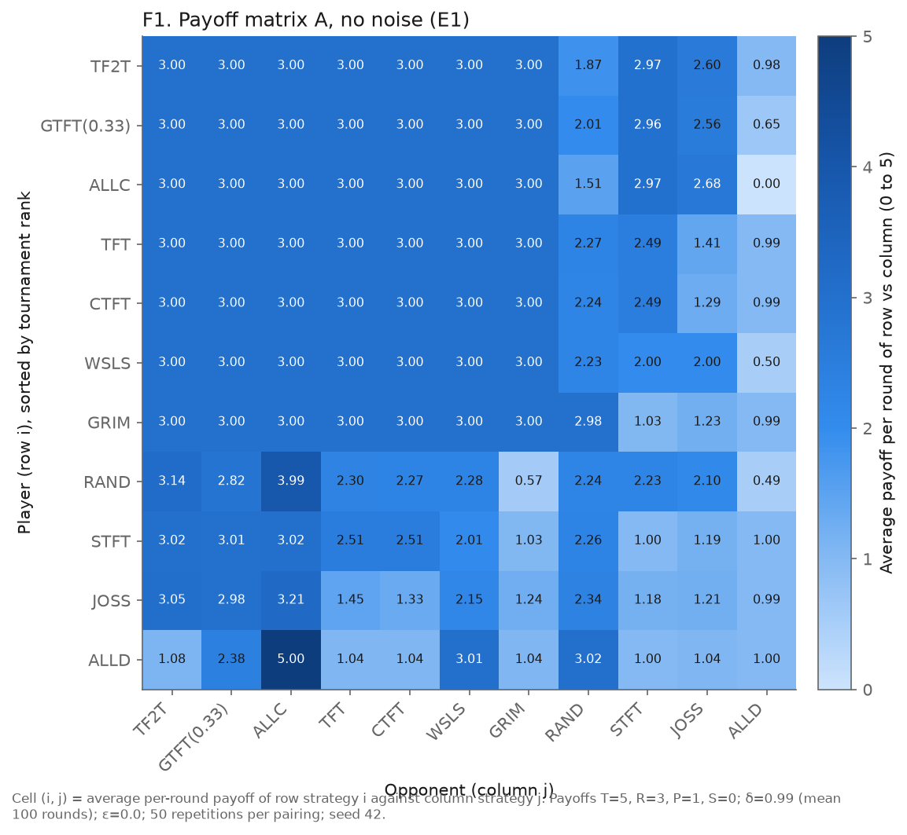{width=0.62}

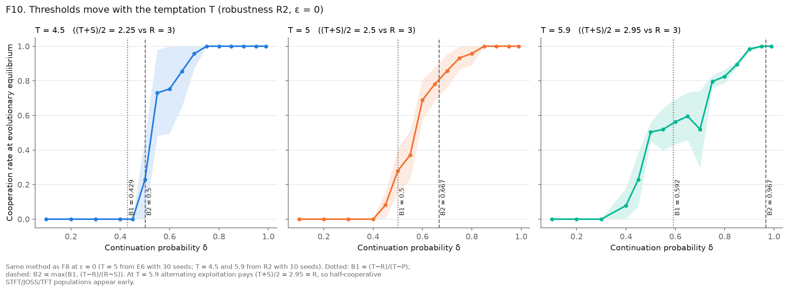{width=0.95}

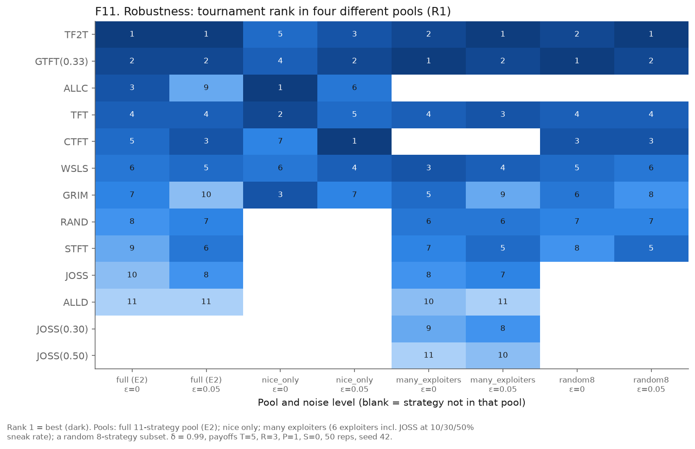{width=0.75}
